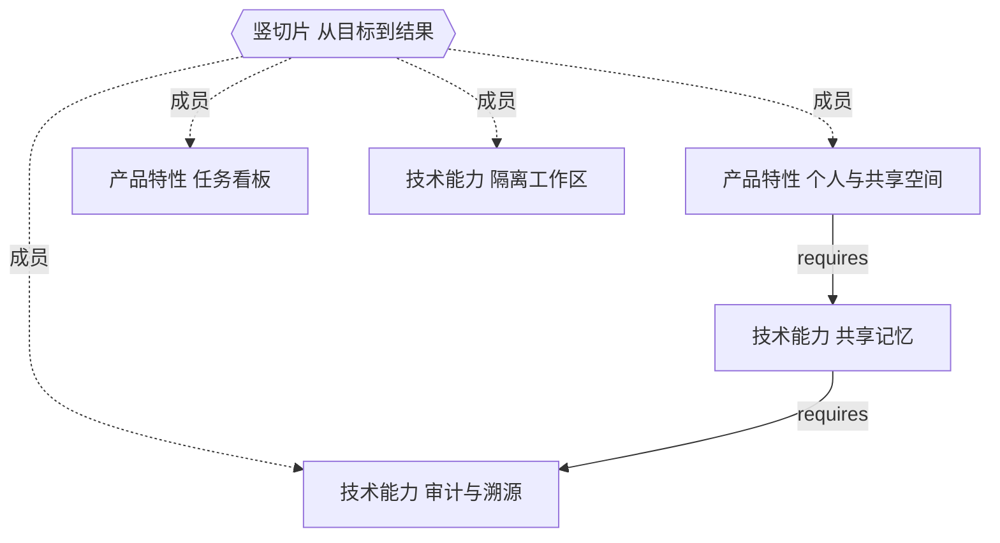

# 产品项目图式横比模型（Product-Project Graphical Cross-Comparison Model）

## Question

在不预先裁决架构、也不先给采用结论的前提下，ZAgentic 如何以**固定场景集**为公共坐标系，把多个产品项目的能力结构与上下文条件拆成各自独立的图与旁挂清单，并生成**逐条可追溯的差异清单**？

## Scope

本文拥有：横比 item 的图定义（节点 / 竖切片超边 / 依赖边 / 横切路径 / 图内关系约束）、**上下文条目契约（非图元素）**、固定场景集与可选场景集的契约、场景映射契约、三阶段流程、原子化判据、未决关系的 Human 裁决契约、差异条目的形状与四态、摘要指标（不参与结论）、复核条件、报告结构，以及与《开源能力拟合决策模型》的可选回灌接口。

具体项目的研究事实、证据 ID、版本 pin、场景集实例与报告数据由各自的 evidence artifact 拥有；本文只定义它们必须长成什么形状。

本文是**方法论约定**。文中的 YAML 形状、复核条件与报告模板是纸面契约，用于约束产出形状；当前没有实现体，不表示已有脚本或门禁在运行。

## Boundaries

- 本模型是**描述与对比**方法，不做采用/拒绝裁决。`A / B / C / D` 仍由母模型判定。
- 图是结构化表示，不是证据。每个节点与边必须绑定固定版本的一手材料，或显式标注证据状态。
- **固定场景集是外部尺子**：由 Human 独立给定，不来自任何 `Graph_i`；只描述可观察的用户场景（起点 / 终点 / 可观察结果），**不规定任何节点、模块或实现划分**。
- 场景集可携带 `domain` 级上下文条目（跨域公共的约束 / 数据契约 / 外部依赖 / 参与主体），但它们**仍不规定任何节点、模块或实现划分**。
- **`V` 只含两类可独立验收的能力单元**（`F` / `T`）。非功能约束、数据资产、外部依赖、参与主体一律作为上下文条目旁挂，不得写进 `V`、竖切片成员集或有向依赖图。
- 场景集之前不存在跨项目节点对齐。各项目按自己的语义建图；节点语义等价只在同一场景映射内按需裁决并留痕。
- **摘要指标不参与结论**：不得用于排序、裁决、回灌或确定优先级。差异条目清单是唯一结论载体。
- 未定义关系不得默认成「存在依赖」或「无依赖」，必须进入未决关系登记簿由 Human 裁决；执行 Agent 不得自行补边、自行推断语义等价或默认「无依赖」。
- 不因项目热度、README 长度、文件数或节点数量推断模块构成或工作量。
- 本模型不授权实现、发布或任何不可逆副作用；后续执行仍遵循对应 workflow。

适用范围：多个产品项目的产品方案 / 技术方案讨论之前，需要回答「同一可观察场景在不同项目由哪些可独立验收的单元支撑、哪些节点必须一起实现、哪些上下文条件不同」。不适用于：单候选能力拟合（走母模型）、实现层代码 diff、性能基准、发布后的运维对比。

## 目标

把「产品概念明确但模块构成不清晰」变成可枚举的节点集合；把「大多数内容要从 0 到 1」定位到**同一场景下各项目支撑组合的差异**；把「人和 Coding Agent 困在细节里」转化为：先由外部场景集决定比较坐标，再由 Human 裁决边界，最后让 Agent 在已裁决的边界内落地。

横比矩阵只能回答「某项目有没有某个能力」；本模型额外回答四件事：同一可观察场景在不同项目由哪些节点组合支撑；某项目明确不覆盖哪些场景；哪些节点因互相依赖而不可单独交付；哪些上下文条件被满足或违反。后四者才是模块构成与工作量讨论的真实输入，且全部以**差异条目**形式给出，而不是一个分数。

## 与母模型的关系（可选回灌，非替代）

| 项 | 母模型：开源能力拟合决策模型 | 本模型：图式横比模型 |
| --- | --- | --- |
| 问题 | 一个外部能力相对既定 `R` 应采用 / 扩展 / 选择性复用 / 继续搜索 | 多个产品项目在同一组场景下结构差异是什么 |
| 输入 | `R`（需求集合）+ 固定版本候选 | 多张 `Graph_i` + 固定版本一手材料 + Human 给定的固定场景集（含 `domain` 级上下文条目）+ 未决关系裁决记录 |
| 基本单位 | 单位能力 | 节点 + 竖切片超边 + 依赖边 + 差异条目 |
| 中间产出 | `R × O` 证据矩阵（其流程第 3 步「建立」，是产出不是输入） | 场景映射表 + 差异条目清单 |
| 输出 | `A / B / C / D` 分类与决策记录 | 差异条目清单（结论）+ 摘要指标（非结论） |
| 状态口径 | 原生支持 / 适配后支持 / 未知 / 不支持 | 同四态 `native / adapted / unsupported / unknown`，参照系为场景 |
| 非能力范畴 | 「接口、语义、数据模型、生命周期、许可、运行方式」是 `C = Compose(...)` 的兼容性验证项与 `E` 的成本分量，不是 `O` 能力 | 同构分工：作为上下文条目旁挂，判定进差异清单，兼容性与长期成本仍由母模型判 |

**符号避让**：母模型 `G = R − C` 表示能力缺口；本模型的图一律写作 `Graph_i`，不使用 `G_i`。母模型 `R × O` 矩阵是其自身产出，不是本模型的输入。

**接口（可选，单向）**：差异条目中状态为 `native` / `adapted` 的能力，以及状态为 `unsupported` 的明确缺口，可作为母模型后续建立 `R × O` 矩阵时的**素材**。母模型是否接纳、如何拆解为单位能力 `O`、如何计算 `G` 与 `E`、如何判定 `A / B / C / D`，均由母模型自己定义。本模型不声明该接口已存在，不重做判定，也不把横比结论写成采用结论。

## 核心模型

### 横比 item 的图定义

对任一产品项目 `P_i`，横比 item 是一张独立的有向图：

```text
Graph_i = (V_i, S_i, D_i, X_i, RC_i)
V_i = F_i ∪ T_i,  |V_i| ≥ 1
```

`V_i` 只含两类**可独立验收的能力单元**；不属于这一范畴的事实见下节「上下文条目」。

| 元素 | 记号 | 定义 | 基数 |
| --- | --- | --- | --- |
| 产品特性节点 | `F` | 用户可感知、可独立陈述与验收的产品功能或价值单元 | 0..n |
| 技术能力节点 | `T` | 实现侧可独立陈述与验收的能力单元 | 0..n |
| 竖切片超边 | `S` | `s = (members ⊆ V_i, scenario, evidence)`，把一个可观察的端到端用户场景连成一组 `F` 与 `T` | 1..n |
| 依赖边 | `D` | 有向 `d = (from, to, evidence)`，语义恒为 `requires`：实现 `from` 需要 `to` | 0..n |
| 横切路径 | `X` | `x = (statement, appears_in ⊆ S_i, evidence)`，记录在多条竖切片中重复出现的体验路径 | 0..n |
| 图内关系约束 | `RC` | `rc = (kind, members, evidence)`，`kind ∈ {mutually-exclusive, ordering}`，不进有向依赖图 | 0..n |

节点属性：`id` / `statement` / `acceptance` / `evidence-ref`（可为空）/ `semantic-owner`（可选，复用 `Native semantic owner` 语义）/ `indivisible` 标记。**元素级不承载供给状态**；供给判定只发生在差异条目上，且以场景为参照系。

**为什么 `D` 只保留 `requires`**：`mutually-exclusive` 是选择约束、`ordering` 是时序约束，二者不是实现依赖；`co-varies`（共变）需要跨版本观察，与「固定版本 pin + 一手材料证据」无兼容的证据来源，因此不设该类型；`semantic-ownership` 是归属声明，下沉为节点属性；`unknown` 是状态不是关系类型，交回未决关系登记簿。只有 `requires` 能进入强连通分量、依赖闭包与扇入的计算。

**共享节点**：同一 `v` 可出现在多条 `S` 中，标为复用候选；是否补一条 `D` 须显式裁决。
**孤儿节点**：不被任何 `S` 连接的 `v`，必须显式列出，进入「场景映射缺口清单」作为 `unknown` 验证计划的输入，不得静默删除。

### 上下文条目（不是图元素）

有四类事实常被误当成节点，但它们都**不是可独立验收的能力单元**，因此不进 `V_i`，也不进 `S.members` 与有向依赖图：

| 类别 | `kind` | 例子 | 为什么不是节点 |
| --- | --- | --- | --- |
| 非功能约束 | `constraint` | 数据不出域、响应 < 200ms、许可与合规要求 | 只有「满足 / 违反」，没有独立验收条件；它限制的是实现可接受性 |
| 数据契约 | `data-contract` | 长期记忆对象、页级元数据、schema 与生命周期 | 是被操作的事实载体，不是功能或能力 |
| 外部依赖 | `external-dep` | 第三方 API、模型服务、provider 条款 | 供给来自外部，本模型并未「实现」它 |
| 参与主体 | `actor` | Human operator、审批人、执行 Agent | 是场景中的角色，不是被交付的单元 |

**为什么不扩 `V`**：把四类塞进节点集合，会让原子化判据（可独立陈述 / 可独立验收 / 不共用验收条件）对它们失效；`S.members ⊆ V` 会把约束当成场景成员；强连通分量、依赖闭包与扇入在异构图上语义崩坏（依赖边要不要连一条合规约束？）。母模型也把它们放在 `C` 的兼容性验证项与 `E` 的成本分量里，不当作 `O` 能力——本模型沿用同一分工。

**形状与归属**：上下文条目是 SoT 的顶层旁挂清单，**不给图记号、不进入 `Graph_i` 元组**：

```yaml
context-entries:
  - id: CTX::data-residency
    scope: project                       # project | domain
    kind: constraint
    statement: <可陈述的条件>
    evidence-ref: <固定版本一手材料>
```

- `scope: domain` 的条目归**固定场景集**所有，由 Human 与场景集一并给定（跨域公共要求），仍受「不规定节点 / 模块 / 实现划分」约束；
- `scope: project` 的条目归各自 `Graph_i` 所有，记录项目私有事实，在 Stage 2 收集；
- 二者形状相同，都不进 `V`、不进 `S.members`、不进依赖图。节点上的 `semantic-owner`（复用 `Native semantic owner`）回答「谁拥有 durable facts」，与 `data-contract` 互补而非重复。

**符号避让**：本节的 `kind: constraint`（非功能条件）与图内 `RC`（`mutually-exclusive` / `ordering` 的关系约束）词形不重叠，不构成同名异义。单字母 `C` 在本文档中**只**指母模型 `C = Compose(...)`；复核条件写 `CHK-nn`，图内关系约束写 `RC`。词表 `Flagged ambiguities` 保留该改名记录。

**差异如何表达**：差异条目用 `context-refs` 引用上下文条目，并以 `context-verdicts` 逐条判定。这是逐条清单，不是标量，不制造假精确。

### 不变量

1. 每元素有稳定 ID，以及固定版本证据绑定或显式证据状态。
2. **竖切片的成员列表是 SoT，Mermaid 只是投影**。Mermaid 无原生超边，投影用切片中间节点 + 虚线成员边表示；不得把投影里的中间节点当真实节点，也不得从投影反推成员集合。
3. `unknown ≠ unsupported`：`unknown` 是证据缺口（既无覆盖证据、也无否定陈述）；`unsupported` 是已确认不覆盖，须绑定一手材料中的显式否定陈述。前者只进缺口清单，后者是结构性差异。
4. 各 `Graph_i` 独立建成，不互相引用、不预先对齐；跨项目对齐只经场景映射发生。
5. 未决关系必须登记；未裁决时按 `unknown` 处理，不进差异条目的定量部分。
6. 摘要指标不参与结论。
7. 固定场景集只描述场景，不规定节点或模块。
8. 上下文条目不进 `V`、不进 `S.members`、不进有向依赖图；`domain` 级条目同样不规定实现划分。
9. 单字母 `C` 只用于引用母模型 `C = Compose(...)`；本模型的图内关系约束写 `RC`、复核条件写 `CHK-nn`，不得回退到 `C` / `C1`… 等旧记号。

### 人读投影示例（非 SoT）



横切路径 `X`、图内关系约束 `RC` 与上下文条目都不画进人读投影，只见于各自的 SoT 清单；这样投影里唯一的中间节点是切片 `S1`，不会被误读为真实节点。

### 机器可读 SoT 最小形状

```yaml
project: P1
version-pin: <commit-or-release>
scene-set-ref: <场景集 ID + 版本 pin>    # Stage 3 输入，非 Graph_i 所有
nodes:
  - id: F::personal-shared-scope
    kind: feature
    statement: <可独立陈述的单元>
    acceptance: <可独立验收的判据>
    evidence-ref: <固定版本一手材料>      # 可为空；空则标 unknown
  - id: T::scoped-memory
    kind: capability
    statement: <可独立陈述的单元>
    acceptance: <可独立验收的判据>
    evidence-ref: <固定版本一手材料>
slice-edges:                               # 竖切片，成员列表是 SoT
  - id: S::goal-to-result
    members: [F::personal-shared-scope, T::scoped-memory]
    scenario: <起点 / 终点 / 可观察结果>
    evidence-ref: <固定版本一手材料>
cross-cutting-paths:                       # 横切路径，不与 S 并列
  - id: X::approval-and-recovery
    statement: <重复出现的体验路径>
    appears_in: [S::goal-to-result]
    evidence-ref: <固定版本一手材料>
dependency-edges:                          # 语义恒为 requires
  - id: D::scope-requires-memory
    from: F::personal-shared-scope
    to: T::scoped-memory
    evidence-ref: <固定版本一手材料>
relation-constraints:                      # 图内关系约束，不进有向依赖图
  - id: RC::either-or
    kind: mutually-exclusive
    members: [F::..., T::...]
    evidence-ref: <固定版本一手材料>
context-entries:                           # 旁挂清单，不属于 Graph_i 元组
  - id: CTX::data-residency
    scope: project
    kind: constraint
    statement: 摄入过程数据不出域
    evidence-ref: <固定版本一手材料>
  # scope: domain 的条目由场景集 artifact 持有，不在此文件内
scene-mapping:                             # Stage 3 产出
  - slice: S::goal-to-result
    scene: SC::goal-to-result
    ruling-ref: <Human 裁决记录>
difference-entries: []                     # Stage 3 产出，见下
undeclared-relations: []
```

稳定 ID 命名：`F::` / `T::` / `S::` / `X::` / `D::` / `RC::` / `CTX::` / `SC::` / `DE::`；跨项目引用写作 `<project-id>::<element-id>`。ID 一旦发布不复用、不重命名，语义变更须新建 ID 并记录旧 ID 的退役理由。

### 差异条目（唯一结论载体）

```yaml
difference-entries:
  - id: DE::0001
    scene: SC::goal-to-result
    project: P1
    verdict: native                       # native | adapted | unsupported | unknown
    supporting-slices: [S::goal-to-result]
    node-set: [F::..., T::...]
    evidence-refs: [...]
    mapping-ruling-ref: <场景映射裁决>
    context-refs: [CTX::data-residency]
    context-verdicts:
      - ref: CTX::data-residency
        verdict: satisfied                # satisfied | violated | unknown
        verification-plan: <仅 unknown 必填>
    verification-plan: <仅 verdict 为 unknown 时必填>
```

四态判据的参照系是 `scene`，不是我方的架构：

| 状态 | 判据 |
| --- | --- |
| `native` | 至少一条竖切片映射到该场景，成员完备，且有一手材料证据 |
| `adapted` | 有覆盖证据，但需适配才能支撑该场景；须点明适配对象与证据 |
| `unsupported` | 一手材料中有**显式否定陈述**（不覆盖该场景 / 明确排除）；必须绑定该陈述的 `evidence-ref` |
| `unknown` | 既无覆盖证据、也无否定陈述；不进清单定量部分，只进缺口清单并附最小验证计划 |

**上下文判定三态**是另一套枚举，不可与供给四态混用：`satisfied` = 有一手材料证据表明该条件在该项目下成立；`violated` = 有显式否定证据（材料明确不满足或明确排除）；`unknown` = 两者皆无，只进缺口清单并附最小验证计划。`context-verdicts` 不改变 `verdict`，它补的是「能力结构相同、但上下文条件不同」这一类差异——例如两个项目都 `native` 支撑同一场景，一个要求数据不出域、另一个依赖第三方 LLM API，差异必须在这里可见，否则横比会漏掉最关键的产品定位差别。

## 原子化判据

**节点**（同时满足三条才算一个原子节点）：① 可独立陈述；② 可独立验收；③ 不与其他节点共用同一验收条件。

**停止拆分**：若再拆出的两个碎片总是同时出现、且必然由同一条 `requires` 依赖边绑定，则停止并合并为一个节点，标 `indivisible` + 记录合并理由。原子化不是越细越好；目的是让每个节点都能被单独质疑「能否复用」。

**竖切片**：一条边 = 一个可独立观察的端到端用户场景，必须写出起点、终点与可观察结果；至少连接 1 个 `F` 与 1 个 `T`。

**横切路径**：一条路径 = 在 ≥2 条竖切片中重复出现的体验路径，必须写出 `appears_in` 与证据。它不参与竖切片的成员下界检查，也不计入共享度分子。

**依赖边**：`from` 的实现需要 `to`，且该依赖会影响「能否单独复用 `from`」。耦合不是「相关」「都在同一个模块里」，也不是文档里相邻出现。

**反例（明确禁止）**：把整个产品当一个节点；把技术栈名或框架名当技术能力；把 UI 页面当竖切片；把「看起来相关」当依赖边；把横切路径写进 `S`；把 Mermaid 投影的中间节点写进节点清单；**把非功能约束 / 数据资产 / 外部依赖 / 参与主体写进 `V`**（它们走上下文条目）。

## 三阶段流程

### Stage 1 — 每个项目一张独立的横比 item 图

- 输入：该项目固定版本的一手材料（README / PRD / 设计文档 / 可复现实验）。
- 动作：画出 `Graph_i` 初稿，列出 `F_i / T_i / S_i / D_i / X_i / RC_i` 与证据绑定表，并登记 `project` 级上下文条目初稿。
- 约束：**项目之间不互相引用、不预先对齐**。先把每个项目按自己的语义画完整，避免用第一个项目的模块划分去套后面的项目。
- 输出：`Graph_i` 的 SoT（YAML/JSON）+ 人读投影 + 上下文条目初稿 + 未决关系登记簿初稿。

### Stage 2 — 原子化解构（逐项目执行）

| 步 | 动作 | 输出 | 验收 |
| --- | --- | --- | --- |
| a | 产品特性原子化为独立 `F` 节点 | `F_i` 清单 | 每节点过三条原子化判据，含 `acceptance` |
| b | 技术能力原子化为独立 `T` 节点 | `T_i` 清单 | 同上；技术栈名不算能力 |
| c | 用户场景原子化为竖切片 `S` | `S_i` 清单 + 成员集 | 每条写出起点 / 终点 / 可观察结果 |
| d | 重复体验路径登记为横切路径 `X` | `X_i` + `appears_in` | 不并入 `S` |
| e | 共享节点计数（只按 `S`）、补依赖边 `D` 与图内关系约束 `RC` | 共享度表 + `D_i` / `RC_i` | 每个共享节点有「是否补依赖边」的显式结论；孤儿节点进缺口清单 |
| f | 汇总**可选场景集**（过程材料） | 可选场景集 | 逐项目原样摘录，禁止归并 / 去重 / 语义等价判断 |
| g | 未定义关系 → 与 Human 讨论 → 确定处理方式 | 未决关系登记簿（裁决后） | 每条记录有裁决结果、裁决人、生效版本；未裁决项标 `unknown` |
| h | 登记 `project` 级上下文条目 | `CTX_i` 清单 | 每条有合法 `scope` / `kind` 与 `evidence-ref`；不进 `V` |

#### 2-f 可选场景集契约

可选场景集是 Stage 2 执行过程中顺手收集的观察材料，每条形状为 `(project-id, slice-id, 场景原文, evidence-ref)`，在 Stage 2 结束时提交给 Human。

- **用途仅限盲区检查**：供 Human 核对最终场景集有无遗漏，以及识别「把某项目特有场景误当成通用场景」。**不得直接采纳为最终场景集**。
- **Agent 零语义操作**：只逐项目原样摘录并标注来源，不生成「疑似对应」、不去重、不做等价判断。否则 Agent 在 Stage 2 就做了语义裁决，违反 fail-closed。
- **核对留痕**：Human 记录「池中 N 条 → 已覆盖 M / 判为项目特有 K / 其余说明」，并入报告第 4 节。
- 它是过程材料，不进 SoT、不进差异清单、不触发复核条件。

#### 2-g 未决关系 Human 裁决契约

「未定义关系」指：两个节点之间疑似存在依赖，但一手材料既未声明也无法从固定版本证据推定；或一条竖切片的成员集不完整；或 `S → 场景` 的映射无法判定；或同一场景内跨项目节点的语义等价无法判定；或一条上下文条目的 `scope` / 判定无法判定。

登记簿每条必须含：`id` / 涉及元素 / 关系描述 / 候选解释（≥1）/ 影响范围（哪些 Stage 3 结论会被它改变）/ 裁决结果 / 裁决人 / 生效版本。

三种裁决结果：

1. **新增依赖边、竖切片或场景映射**：补证据绑定后纳入 `D_i` / `S_i` / 场景映射表。
2. **判定为不构成关系**：写明理由，标 `not-a-relation`，不进任何对比。
3. **保留不确定**：标 `unknown` + 写出验证计划（最小 PoC 或契约 fixture），该关系不进清单定量部分。

**Fail-closed**：未裁决的项一律按 `unknown` 处理；不得由执行 Agent 自行补边、自行推断语义等价或默认「无依赖」。区分「已裁决但保留不确定」与「未裁决」的机械判据是**登记簿的 `裁决人` 与 `生效版本` 是否非空**：非空者属已裁决的 `unknown`，可进入 Stage 3 并写入缺口清单；为空者是未裁决项，阻塞进入 Stage 3。

### Stage 3 — 场景锚定对比

前置：Human 已给定固定场景集（带版本 pin、产品域一手材料证据与 `domain` 级上下文条目），且 2-g 裁决已完成。

| 步 | 动作 | 输出 |
| --- | --- | --- |
| a | 把每条 `S_i` 映射到场景集中的一个场景；无法映射的进入登记簿 | 场景映射表 + 裁决记录 |
| b | 对每个 `场景 × 项目` 生成一条差异条目，判供给四态与上下文三态、绑证据与映射裁决 | 差异条目清单 |
| c | 同一场景内按需裁决跨项目节点的语义等价；裁决记录必须引用双方 `acceptance` | 场景内等价裁决记录 |
| d | **可选场景集核对**：Human 记录盲区检查结论 | 核对留痕 |
| e | 计算摘要指标，明确标注不参与结论 | 摘要指标区 |
| f | 按固定结构签发报告 | 横比报告 |

`domain` 级上下文条目适用于所有项目；`project` 级只适用于其所属项目。同一条上下文条目若被多个项目引用，判定逐项目给出，不得由一次裁决批量套用。

场景集里若某场景无任何项目覆盖，仍保留该行并标 `unsupported` / `unknown`——这是**绝对参照**，正是外部尺子相对「从 `Graph_i` 归纳」的核心价值。

**摘要指标（不参与结论）**：

```text
证据绑定覆盖率 = 已绑定固定版本证据的元素数 / 全部元素数    # unknown 元素合法存在于分母
竖切片覆盖率   = 被至少一条 S 连接的节点数 / 全部节点数
共享度         = 出现在 ≥2 条 S 中的节点数 / 全部节点数      # 只数竖切片，X 不计入
SCC 规模分布   = D 有向图上每个强连通分量的节点数分布         # 仅环构成「不可单独交付」
最大依赖闭包   = max over v of |closure(v) ∪ {v}|            # 单次交付成本
扇入分布       = 各节点入度分布                               # 变更波及面
未决存量       = 登记簿中裁决人为空的条目数
```

分母中的「元素 / 节点」一律指 `V` / `S` / `D` / `X` / `RC`，**上下文条目不计入任何摘要指标**——它们不是图元素，塞进分母会重复污染覆盖率与共享度。

`SCC` 只在互相依赖（环）时非空；传递依赖闭包按起点定义、可重叠，不是划分；扇入是节点级标量。三者回答三个不同问题，不得合并成一个「耦合团规模」。**无向连通分量不得用于本模型**：忽略 `requires` 的方向，会把可独立交付的依赖方与共享底座绑成一团，系统性虚增工作量单元。

所有摘要指标只作为清单的摘要展示，不得用于排序、裁决、回灌或确定优先级。

## 复核条件

| 条件 | 校验 | 不满足的后果 |
| --- | --- | --- |
| CHK-01 版本与 ID | 每项目有 `version-pin`；场景集有 pin 与来源；每元素有稳定 ID | 不得签发报告 |
| CHK-02 竖切片合法 | 每条 `S` 至少含 1 个 `F` 与 1 个 `T`，写出场景三要素 | 拒绝该边 |
| CHK-03 未决关系 | 裁决人为空的条目不进 Stage 3；`unknown` 不进清单定量部分 | 不得进入 Stage 3 |
| CHK-04 场景集外部性 | 场景集不来自 `Graph_i`；只描述场景、不规定节点 / 模块 | 不得签发报告 |
| CHK-05 场景内等价 | 同一场景内跨项目节点等价有裁决记录，且引用双方 `acceptance` | 该节点对不写入差异条目的共有语义 |
| CHK-06 状态判据 | `unsupported` 绑定显式否定陈述；`unknown` 附验证计划 | 该条目退回 |
| CHK-07 可选场景集 | 逐项目原样摘录、零语义操作；核对留痕存在 | 退回 Stage 2-f |
| CHK-08 孤儿节点 | 孤儿节点显式列出并进入缺口清单 | 就绪度提示，不阻塞 |
| CHK-09 报告结构 | 八节齐全，且区分证据 / Human 裁决 / 假设 | 不得签发报告 |
| CHK-10 上下文条目 | 每条有合法 `scope` / `kind` 与证据；`domain` 级不规定实现划分；`unknown` 判定附验证计划 | 该条目退回 |

任何条件不满足时，产出仍可保留为**过程材料**，但不得标注为已完成的横比报告。

## 报告固定结构（缺节即 CHK-09 不过）

1. 图清单与版本 pin（每项目 commit / release、SoT 路径、固定场景集 pin 与来源，含 `domain` 级上下文条目清单）；
2. 场景映射表与映射裁决记录；
3. **差异条目清单**（逐条：场景 / 项目 / 供给四态 / 支撑切片 / 节点集 / 证据 / 映射裁决 / 上下文引用与三态判定 / 验证计划）；
4. 可选场景集核对留痕；
5. 场景内语义等价裁决记录（含双方 `acceptance` 引用）；
6. 摘要指标（标注「不参与结论」）；
7. 与母模型的可选回灌素材（状态为 `native` / `adapted` / `unsupported` 的条目；明确母模型侧接口待定义）；
8. 完成标准自检（第三方 Agent 能否仅凭报告复核每条差异，并区分**证据 / Human 裁决 / 假设**三类来源）。

每节须标明其中每条陈述属于三类来源中的哪一类；Human 裁决不得写成证据，假设不得写成裁决。

## 约定方、条款与变更流程

- **约定方**：方法论 owner（Human）拥有图定义权、固定场景集与 `domain` 级上下文条目的给定权、盲区核对与全部语义裁决权；执行 Agent 拥有建图、解构、呈递与对比的操作责任，不拥有语义裁决权；evidence artifact owner 拥有具体事实；报告消费者拥有复核权。
- **条款**：Agent 必须给每个元素绑定固定版本证据或显式标注证据状态、显式保留 `unknown`、不自行补边、对可选场景集零语义操作、登记 `project` 级上下文条目且不把它们写进 `V`；Human 必须独立给定场景集与 `domain` 级上下文条目、裁决未决关系与场景内语义等价；报告必须以差异条目清单为唯一结论载体，区分证据 / 裁决 / 假设，并把采用结论留给母模型。
- **变更流程**：图元素词表、上下文条目契约、场景集契约、原子化判据、四态与三态判据、复核条件与报告结构的变更，须由方法论 owner 与报告消费者共同确认后更新本文 `authority-id` 对应的 SSOT，并同步 doc-map 绑定与相关术语；新增项目、版本 pin 变化、场景映射裁决变化只重建受影响的 `Graph_i` 与报告，不改本文定义。任何偏离须在决策记录里写明理由，不得静默接受。

## 决策记录要求

每次应用本模型应留下最小记录：项目清单与版本 pin、固定场景集 ID / pin / 来源、上下文条目清单（`domain` / `project` 分级）与三态判定分布、每张 `Graph_i` 的 SoT 路径、场景映射表、差异条目清单、四态分布、场景内等价裁决、可选场景集核对留痕、摘要指标（标注非结论）、复核条件结果、报告路径、回灌素材、重新评估触发条件。

**完成标准**：第三方 Agent 仅凭该记录，即可复核每张图的结构、每条差异条目的四态判据与证据、上下文三态判定、以及场景映射的裁决依据，并能识别哪些来自固定版本证据、哪些是 Human 裁决、哪些仍是假设。

## 递归与重新评估触发

出现以下任一情况，回到受影响的阶段重建，不得只改结论文字：新增或移除候选项目、任一项目版本 pin 变化、固定场景集变更、上下文条目或其三态判定变更、场景映射裁决变更、任一项目对某场景的状态裁决变更、原子化判据调整、场景内语义等价裁决变更、未决关系裁决变更、母模型 `R` 或 `O` 口径变化。重建时保留旧图与新图，记录差异原因；不复用旧 Evidence ID 或旧裁决编号。

## Source map

- [开源能力拟合决策模型（母模型 SSOT）](open-source-capability-fit-decision-model.md)
- [模型应用指南](../../skills/research/zj-open-source-capability-fit/references/model-application.md)
- [决策记录模板](../../skills/research/zj-open-source-capability-fit/references/decision-record-template.md)
- [ADR 0012：场景锚定对齐决策](../zj-adr/0012-scene-anchored-cross-project-alignment.md)

## Related authority

- [ZAgentic documentation map](../README.md)
- [统一本体 ONTOLOGY.md](../ontology/ONTOLOGY.md)
- [Research bucket architecture](../architecture/ta-skill-bucket-research.md)
