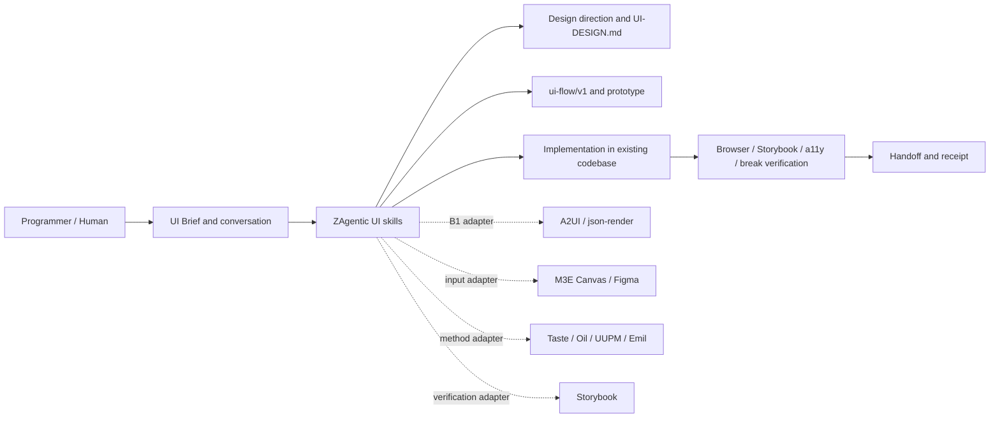
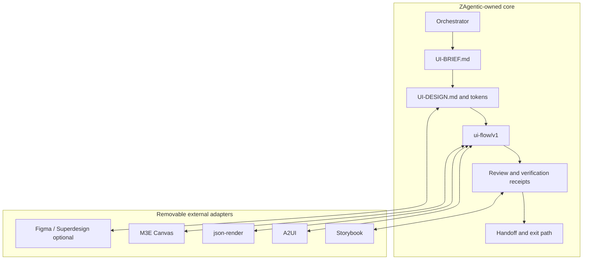

# 调研主题
界面开发全生命周期 Agent skills 的组合式选型与开发方案

没有一个候选同时覆盖视觉判断、结构化 UI 协议、非专家输入、真实代码实现、浏览器反馈、极端数据和组件回归。推荐由 ZAgentic 自有 artifact 与编排承担产品语义和证据链，再以 B1 adapter 选择性接入 Taste/Oil UI/UI UX Pro Max/Emil skills、A2UI/json-render、M3E Canvas 和 Storybook；Superdesign 与 Figma MCP 保持可选 connector，不进入核心底座。

## 输入材料与观察时间
Evidence ledger: `6f5fa6704d73090ff08633a59baba422f3abd41cea68b7bf2b9053de9bf74f12`
Observed: 2026-10-19T07:08:30.374Z

## Key-Value 概念索引
- Key: `decision-frame` — 服务不擅长 UI 设计的程序员，让其通过对话或本地文档完成可审阅、可实现、可验证的界面开发。
- Key: `lifecycle` — 本轮是 experience-version：brief、方向、设计系统、flow、prototype、实现、视觉/动效/数据验证和交接；生产 rollout 暂不承诺。
- Key: `unit-capability` — 外部项目按设计判断、动态 UI 协议、画布输入和工程验证拆成 unit capability，不按整个平台采用。
- Key: `artifact-ownership` — ZAgentic 自有 UI-BRIEF.md、UI-DESIGN.md、ui-flow/v1、review/verification receipt 和 handoff；外部项目只能通过可移除 adapter 读写。
- Key: `fit-model` — 用 R×O 矩阵区分 native/adapted/unknown/unsupported，并用 capability-fit 的 A/B/C/D 闸门判断直接采用、B1 adapter、自有主体或继续搜索。
- Key: `security-and-provenance` — 模型生成组件/动作、远程 MCP、素材和浏览器截图都需要 catalog、审批、来源、许可证、隔离和恢复边界。

Concepts: [[decision-frame]], [[lifecycle]], [[unit-capability]], [[artifact-ownership]], [[fit-model]], [[security-and-provenance]]

## C4 System Landscape
### 候选能力全景与 ZAgentic 边界

## 候选项目表
| Repository | Stars | Topic match |
|---|---:|---:|
| a2ui-project/a2ui | 16738 | 2 |
| anthropics/claude-code | 152299 | 0 |
| Leonxlnx/taste-skill | 98994 | 5 |
| vercel-labs/json-render | 18717 | 2 |
| lnkiai/m3e-canvas | 9490 | 7 |
| emilkowalski/skills | 47448 | 0 |
| nextlevelbuilder/ui-ux-pro-max-skill | 137339 | 2 |
| oil-oil/oil-ui | 1795 | 5 |
| superdesigndev/superdesign-skill | 841 | 0 |
| storybookjs/storybook | 91332 | 4 |
| figma/mcp-server-guide | 2089 | 5 |

## 深读项目卡片
### a2ui-project/a2ui
受 catalog 约束的 streaming-first、跨框架声明式 UI protocol；适合做动态 UI adapter，不负责视觉方向和全生命周期编排。

- Claim `C01`

### anthropics/claude-code frontend-design
官方 plugin 中的 frontend-design skill 提供视觉方向、字体、配色、动效和上下文实现方法；适合作为方法和 packaging 参考。

- Claim `C02`

### Leonxlnx/taste-skill
把 art direction、真实素材、浏览器 inspect 和截图修复组成 anti-slop workflow；适合抽取到方向与视觉复审。

- Claim `C03`

### vercel-labs/json-render
通过 catalog prompt、render-ui MCP tool、json spec 和 React app 形成 generative UI seam；适合 React 垂直切片 PoC。

- Claim `C04`

### lnkiai/m3e-canvas
以 JSON document、画布 refinement、屏幕 flow 和 coding prompt 连接非专家与 Agent；适合输入适配器。

- Claim `C05`

### emilkowalski/skills
将 motion build/review、prototype、library choice 和 break UI 拆成单一职责 skills；edit-feedback-loop 仍有证据缺口。

- Claim `C06`

### nextlevelbuilder/ui-ux-pro-max-skill
以行业/风格/颜色/字体/UX 数据和 checklist 生成 design-system；适合选择性复用数据组织与检索思想。

- Claim `C07`

### oil-oil/oil-ui
通过多方向比较页、用户选择和截图 refinement 形成设计循环；适合抽取交互形态而非整体采用。

- Claim `C08`

### superdesigndev/superdesign-skill
提供外部 canvas、design system、replica、branch 和 flow；CLI/service/login 责任较厚，保留 connector/PoC。

- Claim `C09`

### storybookjs/storybook
以 stories、Agent eval、Playwright/Vitest、a11y/docs addons 承接组件文档与回归验证；不是视觉方向引擎。

- Claim `C10`

### figma/mcp-server-guide
提供 Figma design context、variables、Code Connect 和远程 canvas 写回的 connector 参考；外部服务/seat/terms 责任不可内化。

- Claim `C11`

## 方案族及适用场景对比
### role-families
设计判断候选（Claude frontend-design、Taste、Oil UI、UUPM、Superdesign、Emil）互补但不能拥有 ZAgentic artifact；它们的共同增量是把 taste/方向/复审/动效/极端数据从隐性经验变成可执行流程。

Claims: `C02`, `C03`, `C06`, `C07`, `C08`, `C09`

### protocol-vs-design
A2UI 和 json-render 解决的是模型输出到受信组件 renderer 的协议与 catalog 问题，M3E 解决的是人和 Agent 之间的结构化画布输入；三者都不能替代设计方向和页面语义。

Claims: `C01`, `C04`, `C05`

### feedback-and-input
M3E 的 JSON document/refinement、Taste 的浏览器 inspect、Oil UI 的比较页和 Superdesign 的 branch/replica 分别覆盖输入、检查、选择和连续迭代；本地 artifact 必须把这些结果统一起来。

Claims: `C03`, `C05`, `C08`, `C09`

### engineering-verification
Storybook 的 stories/a11y/docs/test seam 最适合作为实现后的工程验证入口；视觉方向和动效判断应由独立 skills 先完成，再生成验证 fixtures。

Claims: `C06`, `C10`

### ownership-and-alternatives
全平台采用会把远程服务、runtime、版本、凭据和设计语义责任一起引入；协议优先会遗漏设计质量；设计优先会遗漏安全 catalog 与回归。因此自有核心 + 可移除 B1 adapters 是风险最小且可验证的组合。

Claims: `C01`, `C04`, `C09`, `C11`, `C12`

## C4 Context/Container 与子主题图
### 核心容器与外部 adapter 的所有权

## 关键技术指标矩阵
| Metric | Definition | Unit | Method | Condition | Expected |
|---|---|---|---|---|---|
| direction-choice-time | 用户从 brief 看到可比较方向到选定一个方向的耗时 | minutes | 记录 direction workflow timestamps 和 user choice | 固定 demo brief，三次独立运行 | 中位数 <= 10 分钟 |
| direction-divergence | 三个候选方向在 layout/type/palette/key imagery 四轴中的独立差异数 | axes | 由 direction card checklist 和截图审查计数 | 每两个方向至少两个差异轴 | 所有 pair >= 2 axes |
| artifact-resume-rate | 新会话只读本地 artifacts 后能恢复的既有设计决策占比 | % | resume fixture 对比决策清单和恢复结果 | 不读取旧对话，不访问远程服务 | >= 90% |
| implementation-slice-rate | 选定方向能生成可运行页面并至少产出一个 component story 的比例 | % | 对固定 React/Next.js slice 运行 implement + components | 三次从 brief 到代码的完整运行 | 100% |
| visual-blocker-rate | 390/768/1440 视口和键盘/reduced-motion 检查中的 blocker 数量 | blockers/run | browser screenshot + deterministic review receipt | 固定字体、素材和浏览器版本 | 0 blockers |
| worst-case-coverage | 长文本、空态、错误态、一条数据、1000 条数据、多语言等 fixture 被执行的覆盖率 | % | zj-ui-break fixture manifest 对运行日志做集合比对 | 每个 component story 至少一次 | >= 95% |
| adapter-removability | 删除单个外部 adapter 后仍可读取/编辑核心 artifact 并完成本地流程的比例 | % | 逐 adapter 删除环境并运行 golden fixtures | 不允许重新生成核心语义 | 100% |
| verification-provenance | verification receipt 中可回溯到 source artifact、commit、fixture 和命令的结果比例 | % | receipt schema audit | 每次 Experience Version 运行 | 100% |

## 建议、限制与待验证事项
### overall-choice
选择 ZAgentic 自有 artifact/编排为主体（C），外部 unit capability 采用不维护 fork 的 B1 adapter。核心持有 UI-BRIEF.md、UI-DESIGN.md、ui-flow/v1、review/verification receipt 和 handoff；Taste/Oil/UUPM/Emil 先以方法或 adapter 进入，A2UI/json-render/M3E/Storybook 按项目启用。

Comparisons: `role-families`, `protocol-vs-design`, `ownership-and-alternatives`

### core-development
先开发 `zj-ui-brief`、`zj-ui-discover`、`zj-ui-direction`、`zj-ui-design-system`、`zj-ui-flow`、`zj-ui-prototype`、`zj-ui-visual-review`、`zj-ui-break`、`zj-ui-verify` 和 `zj-ui-handoff`，用一个 React/Next.js 表单/审批流完成 experience-version。

Comparisons: `feedback-and-input`, `engineering-verification`

### adapter-path
第一轮 adapter PoC 采用 json-render（React 动态 UI）+ A2UI（协议/跨框架对照）+ M3E（两屏移动 flow 输入）+ Storybook（stories/a11y/viewport/interaction 验证）。每个 adapter 必须有版本锁、golden fixture、丢失字段 warning、服务失败 fallback 和删除后的本地回退。

Comparisons: `protocol-vs-design`, `engineering-verification`, `ownership-and-alternatives`

### paths-to-avoid
不要把 Superdesign、Figma MCP 或任一设计 skill 作为唯一 SSOT；不要让 A2UI/json-render runtime 侵入所有项目；不要把 screenshot pass 当作设计质量完成；不要把 unregistered model actions 直接执行。

Comparisons: `feedback-and-input`, `ownership-and-alternatives`

### remaining-risks
剩余风险是：外部 schema/skill 变化会造成 adapter 漂移；Figma/Superdesign 等远程服务可能不可用；生成式 UI 可能输出未注册组件或危险动作；浏览器、字体和网络会造成视觉检查不稳定；素材许可证和 provenance 可能缺失；多个 skills 可能抢占同一请求。必须用 schema lock、golden fixtures、本地 artifact、catalog/approval、容器化 browser、asset manifest 和 capability precedence 约束这些风险。

Comparisons: `role-families`, `protocol-vs-design`, `ownership-and-alternatives`

- Unknown: vercel-labs/json-render / design-direction
- Unknown: emilkowalski/skills / design-direction
- Unknown: emilkowalski/skills / edit-feedback-loop
- Unknown: oil-oil/oil-ui / agent-composition
- Unknown: superdesigndev/superdesign-skill / agent-composition

## 来源清单
- [a2ui-project/a2ui@cbaa5ee62c737b50d0695c1e5794d0f648b61dca:.agents/skills/a2ui-issue-triage/README.md](https://github.com/a2ui-project/a2ui/blob/cbaa5ee62c737b50d0695c1e5794d0f648b61dca/.agents/skills/a2ui-issue-triage/README.md) — Evidence `1bfdfd5e94988a44aeb4b531`
- [a2ui-project/a2ui@cbaa5ee62c737b50d0695c1e5794d0f648b61dca:.agents/skills/a2ui-issue-triage/README.md](https://github.com/a2ui-project/a2ui/blob/cbaa5ee62c737b50d0695c1e5794d0f648b61dca/.agents/skills/a2ui-issue-triage/README.md) — Evidence `541de57fc9b360ed47039030`
- [a2ui-project/a2ui@cbaa5ee62c737b50d0695c1e5794d0f648b61dca:.agents/skills/a2ui-issue-triage/README.md](https://github.com/a2ui-project/a2ui/blob/cbaa5ee62c737b50d0695c1e5794d0f648b61dca/.agents/skills/a2ui-issue-triage/README.md) — Evidence `d47b00cd5d171b250165af94`
- [a2ui-project/a2ui@cbaa5ee62c737b50d0695c1e5794d0f648b61dca:catalogs/README.md](https://github.com/a2ui-project/a2ui/blob/cbaa5ee62c737b50d0695c1e5794d0f648b61dca/catalogs/README.md) — Evidence `e81904980ddf4b1d27b97743`
- [a2ui-project/a2ui@cbaa5ee62c737b50d0695c1e5794d0f648b61dca:catalogs/README.md](https://github.com/a2ui-project/a2ui/blob/cbaa5ee62c737b50d0695c1e5794d0f648b61dca/catalogs/README.md) — Evidence `bdbee860fef6348d41daea8e`
- [a2ui-project/a2ui@cbaa5ee62c737b50d0695c1e5794d0f648b61dca:dart/a2ui_core/README.md](https://github.com/a2ui-project/a2ui/blob/cbaa5ee62c737b50d0695c1e5794d0f648b61dca/dart/a2ui_core/README.md) — Evidence `f6953a4127c68a86005995ed`
- [anthropics/claude-code@ef7bfdca55d906929fe6b782025b93758c325074:plugins/commit-commands/README.md](https://github.com/anthropics/claude-code/blob/ef7bfdca55d906929fe6b782025b93758c325074/plugins/commit-commands/README.md) — Evidence `8352faca6bd1e3bbf9b2cd41`
- [anthropics/claude-code@ef7bfdca55d906929fe6b782025b93758c325074:plugins/commit-commands/README.md](https://github.com/anthropics/claude-code/blob/ef7bfdca55d906929fe6b782025b93758c325074/plugins/commit-commands/README.md) — Evidence `5dbf30c47a4ed0236c75134b`
- [anthropics/claude-code@ef7bfdca55d906929fe6b782025b93758c325074:plugins/frontend-design/README.md](https://github.com/anthropics/claude-code/blob/ef7bfdca55d906929fe6b782025b93758c325074/plugins/frontend-design/README.md) — Evidence `3ae62d14a0a10b188170186b`
- [anthropics/claude-code@ef7bfdca55d906929fe6b782025b93758c325074:plugins/frontend-design/README.md](https://github.com/anthropics/claude-code/blob/ef7bfdca55d906929fe6b782025b93758c325074/plugins/frontend-design/README.md) — Evidence `cba33c68e0c10fe98ae6e1c7`
- [anthropics/claude-code@ef7bfdca55d906929fe6b782025b93758c325074:plugins/plugin-dev/skills/agent-development/examples/agent-creation-prompt.md](https://github.com/anthropics/claude-code/blob/ef7bfdca55d906929fe6b782025b93758c325074/plugins/plugin-dev/skills/agent-development/examples/agent-creation-prompt.md) — Evidence `8a8f0deb234e876e80069c7a`
- [anthropics/claude-code@ef7bfdca55d906929fe6b782025b93758c325074:plugins/plugin-dev/skills/command-development/README.md](https://github.com/anthropics/claude-code/blob/ef7bfdca55d906929fe6b782025b93758c325074/plugins/plugin-dev/skills/command-development/README.md) — Evidence `8c3077504ffae0bd1d791c76`
- [Leonxlnx/taste-skill@b9ca2fd8047f4c72d7da90ebc1c1203e57c72cd2:skills/taste-skill/README.md](https://github.com/Leonxlnx/taste-skill/blob/b9ca2fd8047f4c72d7da90ebc1c1203e57c72cd2/skills/taste-skill/README.md) — Evidence `5756cd53618056f488895a9a`
- [Leonxlnx/taste-skill@b9ca2fd8047f4c72d7da90ebc1c1203e57c72cd2:skills/taste-skill/README.md](https://github.com/Leonxlnx/taste-skill/blob/b9ca2fd8047f4c72d7da90ebc1c1203e57c72cd2/skills/taste-skill/README.md) — Evidence `2ac08054a8ac9d133d8ee8f1`
- [Leonxlnx/taste-skill@b9ca2fd8047f4c72d7da90ebc1c1203e57c72cd2:skills/taste-skill/README.md](https://github.com/Leonxlnx/taste-skill/blob/b9ca2fd8047f4c72d7da90ebc1c1203e57c72cd2/skills/taste-skill/README.md) — Evidence `d20c1cf467a0817df8a2160e`
- [Leonxlnx/taste-skill@b9ca2fd8047f4c72d7da90ebc1c1203e57c72cd2:skills/taste-skill/README.md](https://github.com/Leonxlnx/taste-skill/blob/b9ca2fd8047f4c72d7da90ebc1c1203e57c72cd2/skills/taste-skill/README.md) — Evidence `51da5eb7b81e0bd894f7dc58`
- [Leonxlnx/taste-skill@b9ca2fd8047f4c72d7da90ebc1c1203e57c72cd2:skills/taste-skill/README.md](https://github.com/Leonxlnx/taste-skill/blob/b9ca2fd8047f4c72d7da90ebc1c1203e57c72cd2/skills/taste-skill/README.md) — Evidence `2168c942408fe832e3836b5a`
- [Leonxlnx/taste-skill@b9ca2fd8047f4c72d7da90ebc1c1203e57c72cd2:skills/taste-skill/README.md](https://github.com/Leonxlnx/taste-skill/blob/b9ca2fd8047f4c72d7da90ebc1c1203e57c72cd2/skills/taste-skill/README.md) — Evidence `aeb41de7a8ff06ba9faa2fed`
- [vercel-labs/json-render@72568f990e5502c4d3115691facb8ca928a5c9fc:examples/mcp/README.md](https://github.com/vercel-labs/json-render/blob/72568f990e5502c4d3115691facb8ca928a5c9fc/examples/mcp/README.md) — Evidence `102a08a78a10e54c903ea9a8`
- [vercel-labs/json-render@72568f990e5502c4d3115691facb8ca928a5c9fc:examples/mcp/README.md](https://github.com/vercel-labs/json-render/blob/72568f990e5502c4d3115691facb8ca928a5c9fc/examples/mcp/README.md) — Evidence `039a71f2bb48723561081395`
- [vercel-labs/json-render@72568f990e5502c4d3115691facb8ca928a5c9fc:examples/mcp/README.md](https://github.com/vercel-labs/json-render/blob/72568f990e5502c4d3115691facb8ca928a5c9fc/examples/mcp/README.md) — Evidence `68c3f85dff59434e0066931a`
- [vercel-labs/json-render@72568f990e5502c4d3115691facb8ca928a5c9fc:examples/mcp/README.md](https://github.com/vercel-labs/json-render/blob/72568f990e5502c4d3115691facb8ca928a5c9fc/examples/mcp/README.md) — Evidence `f1866754163fa26a5926fa96`
- [vercel-labs/json-render@72568f990e5502c4d3115691facb8ca928a5c9fc:examples/mcp/package.json](https://github.com/vercel-labs/json-render/blob/72568f990e5502c4d3115691facb8ca928a5c9fc/examples/mcp/package.json) — Evidence `193ed3f0de7799b718a7efab`
- [lnkiai/m3e-canvas@627e42321bcf080979da87f40a17dcd432425a95:public/agent.md](https://github.com/lnkiai/m3e-canvas/blob/627e42321bcf080979da87f40a17dcd432425a95/public/agent.md) — Evidence `a6ea210ec38b5379d3e72b25`
- [lnkiai/m3e-canvas@627e42321bcf080979da87f40a17dcd432425a95:public/agent.md](https://github.com/lnkiai/m3e-canvas/blob/627e42321bcf080979da87f40a17dcd432425a95/public/agent.md) — Evidence `12c19b4a1d9d52c54738ecea`
- [lnkiai/m3e-canvas@627e42321bcf080979da87f40a17dcd432425a95:public/agent.md](https://github.com/lnkiai/m3e-canvas/blob/627e42321bcf080979da87f40a17dcd432425a95/public/agent.md) — Evidence `674ec01c1d21e029d52e6cc8`
- [lnkiai/m3e-canvas@627e42321bcf080979da87f40a17dcd432425a95:public/agent.md](https://github.com/lnkiai/m3e-canvas/blob/627e42321bcf080979da87f40a17dcd432425a95/public/agent.md) — Evidence `937d273d9551c93e93e42a51`
- [lnkiai/m3e-canvas@627e42321bcf080979da87f40a17dcd432425a95:public/agent.md](https://github.com/lnkiai/m3e-canvas/blob/627e42321bcf080979da87f40a17dcd432425a95/public/agent.md) — Evidence `288a7c9325e75cc4d1fd41ca`
- [lnkiai/m3e-canvas@627e42321bcf080979da87f40a17dcd432425a95:README.md](https://github.com/lnkiai/m3e-canvas/blob/627e42321bcf080979da87f40a17dcd432425a95/README.md) — Evidence `a1dbb907118a427879d6cf70`
- [emilkowalski/skills@2d228630ba1446365f614a108cb8252f1feda202:README.md](https://github.com/emilkowalski/skills/blob/2d228630ba1446365f614a108cb8252f1feda202/README.md) — Evidence `6e374106843639a1c5496660`
- [emilkowalski/skills@2d228630ba1446365f614a108cb8252f1feda202:README.md](https://github.com/emilkowalski/skills/blob/2d228630ba1446365f614a108cb8252f1feda202/README.md) — Evidence `40a40b0b102a7cfa64c30caf`
- [emilkowalski/skills@2d228630ba1446365f614a108cb8252f1feda202:README.md](https://github.com/emilkowalski/skills/blob/2d228630ba1446365f614a108cb8252f1feda202/README.md) — Evidence `144b85e2b4e9b15b82277d9a`
- [emilkowalski/skills@2d228630ba1446365f614a108cb8252f1feda202:README.md](https://github.com/emilkowalski/skills/blob/2d228630ba1446365f614a108cb8252f1feda202/README.md) — Evidence `275593f73c756ad84fcfcabc`
- [nextlevelbuilder/ui-ux-pro-max-skill@56ea9cf174ed86786187daa9de0e6247cb0747e4:docs/journals/260813-0816-phase-6-accessibility-refresh.md](https://github.com/nextlevelbuilder/ui-ux-pro-max-skill/blob/56ea9cf174ed86786187daa9de0e6247cb0747e4/docs/journals/260813-0816-phase-6-accessibility-refresh.md) — Evidence `4b2e010be5b5f41a9c804861`
- [nextlevelbuilder/ui-ux-pro-max-skill@56ea9cf174ed86786187daa9de0e6247cb0747e4:docs/journals/260813-0816-phase-6-accessibility-refresh.md](https://github.com/nextlevelbuilder/ui-ux-pro-max-skill/blob/56ea9cf174ed86786187daa9de0e6247cb0747e4/docs/journals/260813-0816-phase-6-accessibility-refresh.md) — Evidence `dea8fd35f896212c2cd57b5b`
- [nextlevelbuilder/ui-ux-pro-max-skill@56ea9cf174ed86786187daa9de0e6247cb0747e4:docs/journals/260813-0816-phase-6-accessibility-refresh.md](https://github.com/nextlevelbuilder/ui-ux-pro-max-skill/blob/56ea9cf174ed86786187daa9de0e6247cb0747e4/docs/journals/260813-0816-phase-6-accessibility-refresh.md) — Evidence `4bfcdccc2945eb1be228a763`
- [nextlevelbuilder/ui-ux-pro-max-skill@56ea9cf174ed86786187daa9de0e6247cb0747e4:docs/journals/260813-0816-phase-6-accessibility-refresh.md](https://github.com/nextlevelbuilder/ui-ux-pro-max-skill/blob/56ea9cf174ed86786187daa9de0e6247cb0747e4/docs/journals/260813-0816-phase-6-accessibility-refresh.md) — Evidence `a31db8dcd9b57f91d0e8c7ef`
- [nextlevelbuilder/ui-ux-pro-max-skill@56ea9cf174ed86786187daa9de0e6247cb0747e4:README.md](https://github.com/nextlevelbuilder/ui-ux-pro-max-skill/blob/56ea9cf174ed86786187daa9de0e6247cb0747e4/README.md) — Evidence `4b0465cebec839f924a3ef17`
- [nextlevelbuilder/ui-ux-pro-max-skill@56ea9cf174ed86786187daa9de0e6247cb0747e4:README.md](https://github.com/nextlevelbuilder/ui-ux-pro-max-skill/blob/56ea9cf174ed86786187daa9de0e6247cb0747e4/README.md) — Evidence `607b9a4456dd19beb064121b`
- [oil-oil/oil-ui@feb1f95e8cec48bb8ba35181cb66f94f23b1b6fc:README.md](https://github.com/oil-oil/oil-ui/blob/feb1f95e8cec48bb8ba35181cb66f94f23b1b6fc/README.md) — Evidence `676dee71fe8778d04c9b15e9`
- [oil-oil/oil-ui@feb1f95e8cec48bb8ba35181cb66f94f23b1b6fc:README.md](https://github.com/oil-oil/oil-ui/blob/feb1f95e8cec48bb8ba35181cb66f94f23b1b6fc/README.md) — Evidence `7d04d454413ee27aa1128d9f`
- [oil-oil/oil-ui@feb1f95e8cec48bb8ba35181cb66f94f23b1b6fc:README.md](https://github.com/oil-oil/oil-ui/blob/feb1f95e8cec48bb8ba35181cb66f94f23b1b6fc/README.md) — Evidence `81db8563ce3f1db1c5bfc8b8`
- [oil-oil/oil-ui@feb1f95e8cec48bb8ba35181cb66f94f23b1b6fc:README.md](https://github.com/oil-oil/oil-ui/blob/feb1f95e8cec48bb8ba35181cb66f94f23b1b6fc/README.md) — Evidence `1b68fcb27e67be6b5b7126c3`
- [oil-oil/oil-ui@feb1f95e8cec48bb8ba35181cb66f94f23b1b6fc:README.md](https://github.com/oil-oil/oil-ui/blob/feb1f95e8cec48bb8ba35181cb66f94f23b1b6fc/README.md) — Evidence `06a65f09dce70400dc325691`
- [superdesigndev/superdesign-skill@f9f05cd988c247dce6c072eaf9ac6b162f2ffc4b:README.md](https://github.com/superdesigndev/superdesign-skill/blob/f9f05cd988c247dce6c072eaf9ac6b162f2ffc4b/README.md) — Evidence `5a7913cd752c15c8da22d60c`
- [superdesigndev/superdesign-skill@f9f05cd988c247dce6c072eaf9ac6b162f2ffc4b:README.md](https://github.com/superdesigndev/superdesign-skill/blob/f9f05cd988c247dce6c072eaf9ac6b162f2ffc4b/README.md) — Evidence `8afa15922deb0a9bd366c2ba`
- [superdesigndev/superdesign-skill@f9f05cd988c247dce6c072eaf9ac6b162f2ffc4b:README.md](https://github.com/superdesigndev/superdesign-skill/blob/f9f05cd988c247dce6c072eaf9ac6b162f2ffc4b/README.md) — Evidence `7f3e75c801efd87954000d55`
- [superdesigndev/superdesign-skill@f9f05cd988c247dce6c072eaf9ac6b162f2ffc4b:README.md](https://github.com/superdesigndev/superdesign-skill/blob/f9f05cd988c247dce6c072eaf9ac6b162f2ffc4b/README.md) — Evidence `75b258aa03a3a5950a3e24af`
- [superdesigndev/superdesign-skill@f9f05cd988c247dce6c072eaf9ac6b162f2ffc4b:README.md](https://github.com/superdesigndev/superdesign-skill/blob/f9f05cd988c247dce6c072eaf9ac6b162f2ffc4b/README.md) — Evidence `1278c0b9f51f6843b8d1f5a8`
- [storybookjs/storybook@064c650498ad8411c74984ee3188a64be8bd0f20:agent-eval/evals/704-fix-a11y-flow/package.json](https://github.com/storybookjs/storybook/blob/064c650498ad8411c74984ee3188a64be8bd0f20/agent-eval/evals/704-fix-a11y-flow/package.json) — Evidence `9726a10d926aa17c21a5431c`
- [storybookjs/storybook@064c650498ad8411c74984ee3188a64be8bd0f20:agent-eval/evals/815-write-stories-for-fetching-component-without-msw/package.json](https://github.com/storybookjs/storybook/blob/064c650498ad8411c74984ee3188a64be8bd0f20/agent-eval/evals/815-write-stories-for-fetching-component-without-msw/package.json) — Evidence `e576da0141c82d48bf43a74c`
- [storybookjs/storybook@064c650498ad8411c74984ee3188a64be8bd0f20:agent-eval/evals/815-write-stories-for-fetching-component-without-msw/package.json](https://github.com/storybookjs/storybook/blob/064c650498ad8411c74984ee3188a64be8bd0f20/agent-eval/evals/815-write-stories-for-fetching-component-without-msw/package.json) — Evidence `a78d51f6387fc0e664f172eb`
- [storybookjs/storybook@064c650498ad8411c74984ee3188a64be8bd0f20:code/addons/a11y/package.json](https://github.com/storybookjs/storybook/blob/064c650498ad8411c74984ee3188a64be8bd0f20/code/addons/a11y/package.json) — Evidence `0506a88ec421b1cf9306368a`
- [storybookjs/storybook@064c650498ad8411c74984ee3188a64be8bd0f20:code/addons/docs/docs/frameworks/WEB_COMPONENTS.md](https://github.com/storybookjs/storybook/blob/064c650498ad8411c74984ee3188a64be8bd0f20/code/addons/docs/docs/frameworks/WEB_COMPONENTS.md) — Evidence `04f77c927e83ab25ff2e5196`
- [storybookjs/storybook@064c650498ad8411c74984ee3188a64be8bd0f20:code/addons/docs/docs/frameworks/WEB_COMPONENTS.md](https://github.com/storybookjs/storybook/blob/064c650498ad8411c74984ee3188a64be8bd0f20/code/addons/docs/docs/frameworks/WEB_COMPONENTS.md) — Evidence `d992cb06901b1b037d3be389`
- [figma/mcp-server-guide@f2789420e7e8b4e2465dfeb1e12e1fc6a31397e5:skills-figquery/figma-generate-diagram/references/architecture.md](https://github.com/figma/mcp-server-guide/blob/f2789420e7e8b4e2465dfeb1e12e1fc6a31397e5/skills-figquery/figma-generate-diagram/references/architecture.md) — Evidence `03bd06501d9a05812832c842`
- [figma/mcp-server-guide@f2789420e7e8b4e2465dfeb1e12e1fc6a31397e5:skills-figquery/figma-generate-diagram/references/architecture.md](https://github.com/figma/mcp-server-guide/blob/f2789420e7e8b4e2465dfeb1e12e1fc6a31397e5/skills-figquery/figma-generate-diagram/references/architecture.md) — Evidence `b79f38aed924c8112d6e622b`
- [figma/mcp-server-guide@f2789420e7e8b4e2465dfeb1e12e1fc6a31397e5:skills-figquery/figma-generate-diagram/references/architecture.md](https://github.com/figma/mcp-server-guide/blob/f2789420e7e8b4e2465dfeb1e12e1fc6a31397e5/skills-figquery/figma-generate-diagram/references/architecture.md) — Evidence `aab1563aebb2a6ef794b8618`
- [figma/mcp-server-guide@f2789420e7e8b4e2465dfeb1e12e1fc6a31397e5:skills-figquery/figma-generate-diagram/references/architecture.md](https://github.com/figma/mcp-server-guide/blob/f2789420e7e8b4e2465dfeb1e12e1fc6a31397e5/skills-figquery/figma-generate-diagram/references/architecture.md) — Evidence `b7412f0c32c1b377eb9b86d6`
- [figma/mcp-server-guide@f2789420e7e8b4e2465dfeb1e12e1fc6a31397e5:skills-figquery/figma-generate-diagram/references/architecture.md](https://github.com/figma/mcp-server-guide/blob/f2789420e7e8b4e2465dfeb1e12e1fc6a31397e5/skills-figquery/figma-generate-diagram/references/architecture.md) — Evidence `6d0197e8be902530f6bdf5e9`
- [figma/mcp-server-guide@f2789420e7e8b4e2465dfeb1e12e1fc6a31397e5:README.md](https://github.com/figma/mcp-server-guide/blob/f2789420e7e8b4e2465dfeb1e12e1fc6a31397e5/README.md) — Evidence `20da0c338563a126316eb5b8`
